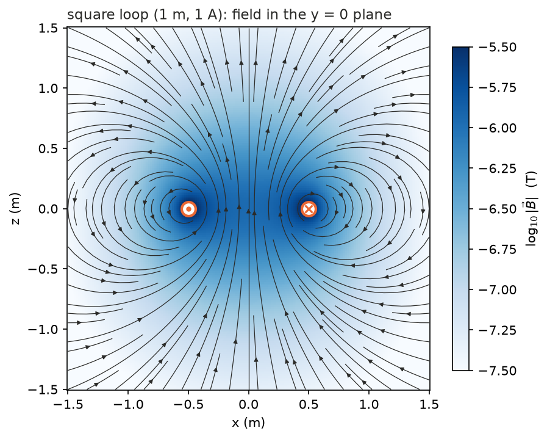
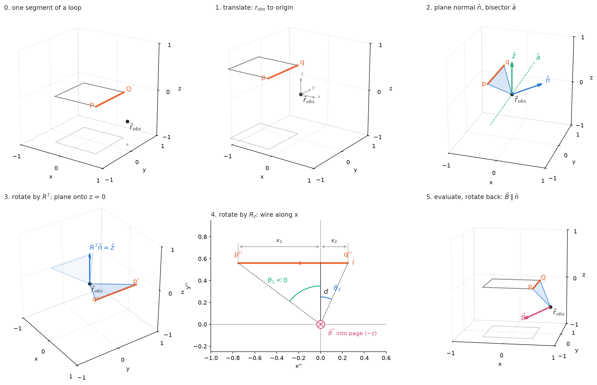
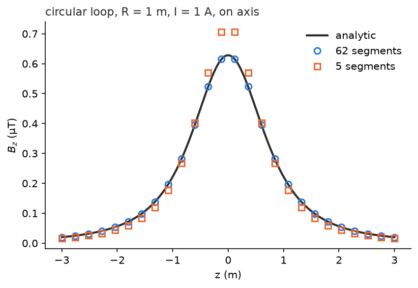

# biotsavart

Magnetic fields of steady currents in free space, from the Biot–Savart law.

A current path is a polyline of straight segments. The field of each segment is evaluated
**in closed form** (no numerical quadrature) and summed. Everything is vectorised with NumPy, so
evaluating millions of observation points is fast. The method is exact for straight wires, so it
suits loops made of long straight sides (rectangular loops, figure-8 loops, cable layouts). Curved
wires work by splitting them into short segments.

<p align="center"></p>

## Installation

```bash
pip install biotsavartlaw
```

or from source:

```bash
git clone https://github.com/mpgriff/biotsavart.git
cd biotsavart
pip install -e .
```

The import name is `biotsavart`. Requires Python ≥ 3.8, NumPy and Matplotlib.

## Quick start

```python
import numpy as np
from biotsavart import Loop, ObsPoint, calc_bfield, mu0

loop = Loop.square(1.0)                     # 1 m square in the z = 0 plane, centred on the origin

# observation points on a regular grid (x, y, z may each be a scalar or a 1D array)
obs = ObsPoint(x=np.linspace(-2, 2, 101), y=0.0, z=np.linspace(-2, 2, 101))

B = calc_bfield(loop.xyz, obs.xyz, I=10.0)  # tesla, shape (101, 101, 3)
Bx, By, Bz = B[..., 0], B[..., 1], B[..., 2]
```

Check: the field at the centre of a square loop of side $a$ is $2\sqrt2\,\mu_0 I/(\pi a)$.

```python
>>> calc_bfield(loop.xyz, np.zeros(3), I=1.0)[2]
1.1313708498984761e-06
>>> 2*np.sqrt(2)*mu0/np.pi
1.1313708498984761e-06
```

## API

| Object | Description |
|---|---|
| `Loop(x, y, z)` | A current path given by its vertices, in order. The current flows from vertex `i` to `i+1`. For a closed loop, repeat the first vertex at the end. |
| `Loop.square(side)` | Square in the $z=0$ plane, centred on the origin, counter-clockwise seen from $+z$. |
| `Loop.fig8(side)` | Figure-8 loop made of two adjacent squares with opposite circulation. |
| `Loop.circle(r, line=0.02)` | Circle approximated by segments about `line` metres long. |
| `loop.xyz` | Vertices as an `(N, 3)` array. This is what `calc_bfield` takes. |
| `ObsPoint(x, y, z, grid=True)` | Observation points. With `grid=True` (default) the inputs are combined with `meshgrid`. With `grid=False` they are matched point by point. Use `.xyz` to get an `(..., 3)` array. |
| `calc_bfield(loop_xyz, xyz, I=1.)` | Field of the whole path at the points `xyz` (any shape ending in 3). Returns the same shape. |
| `bfield_from_line(P, Q, xyz, I=1.)` | Field of a single segment from `P` to `Q`. |
| `mu0` | $4\pi\times10^{-7}$ H/m |

Use SI units throughout: positions in metres, current in amperes, field in tesla. Any `(..., 3)`
NumPy array works as observation points, so `ObsPoint` is only a convenience.

A point that lies exactly on the line of a segment has no well-defined field from that segment.
That segment contributes zero there, and NumPy may warn about the division by zero.

## How it works

<p align="center"></p>

For a straight segment, the Biot–Savart integral has a simple closed form in a particular frame:
the observation point at the origin and the wire parallel to the $x$-axis, from $x_1$ to $x_2$, at
height $y=d$ in the $z=0$ plane. There the field points purely along $z$:

$$B_z = -\operatorname{sign}(d)\,\frac{\mu_0 I}{4\pi |d|}\left(\frac{x_2}{\sqrt{x_2^2+d^2}}-\frac{x_1}{\sqrt{x_1^2+d^2}}\right).$$

`bfield_from_line` moves every (segment, observation point) pair into that frame and back:

0. Take one segment $P\to Q$ of the loop and an observation point $\vec r_{obs}$.
1. **Translate**: $\vec p = P-\vec r_{obs}$, $\vec q = Q-\vec r_{obs}$, so the observation point is the origin.
2. **Find the plane** through the origin, $\vec p$ and $\vec q$. Its unit normal is
   $\hat n = \vec p\times\vec q/|\vec p\times\vec q|$, flipped if needed so that $n_z \ge 0$.
3. **Rotate that plane onto $z=0$** (`getR`). The rotation is a half-turn about the bisector of
   $\hat n$ and $\hat z$, $R = 2\,\hat a\hat a^{\mathsf T}-\mathbb 1$ with $\hat a = (\hat n+\hat z)/|\hat n+\hat z|$.
   It swaps $\hat n$ and $\hat z$, and it is symmetric and its own inverse.
4. **Rotate about $z$** (`getRz`) so the segment points along $+x$. The segment's $y$ coordinate is
   now the perpendicular distance $d$.
5. **Evaluate** the closed form above and **rotate back**: $\vec B = R\,R_z^{\mathsf T}\,\vec B''$.
   The field is therefore always parallel to $\hat n$.

`calc_bfield` repeats this for each segment, vectorised over all observation points, and sums
the contributions. The notebook [examples/implementation_overview.ipynb](https://github.com/mpgriff/biotsavart/blob/main/examples/implementation_overview.ipynb)
goes through each step with figures. It also checks the result against brute-force numerical
integration.

## Validation

`tests/test_physics.py` compares against analytic results: a long straight wire
($B = \mu_0 I / 2\pi r$, along $x$ and $y$) and the on-axis field of a circular loop. The
circle test also checks that a coarse polygon does *not* match, which confirms the test can fail.

<p align="center"></p>

```bash
pip install -e ".[test]"
pytest
```

## License

MIT, see [LICENSE](https://github.com/mpgriff/biotsavart/blob/main/LICENSE).
